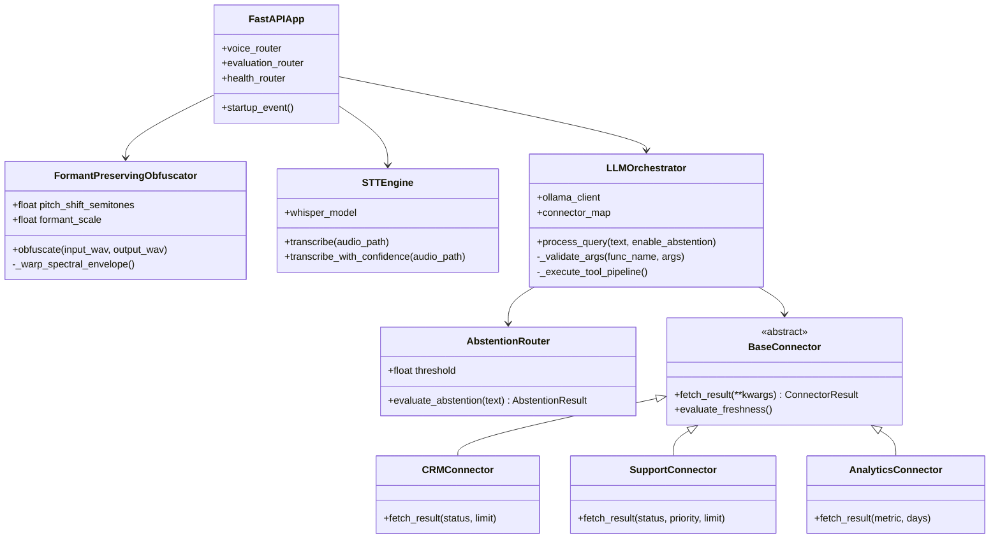
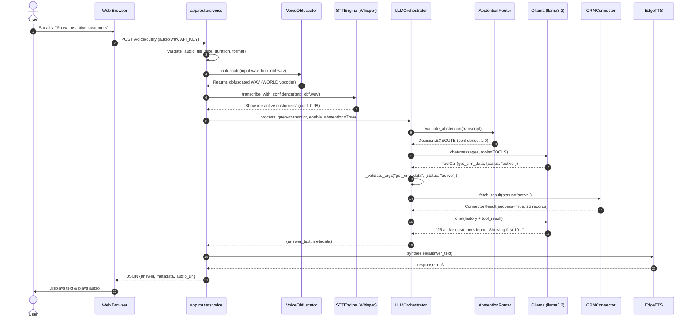
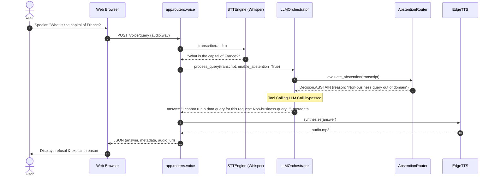
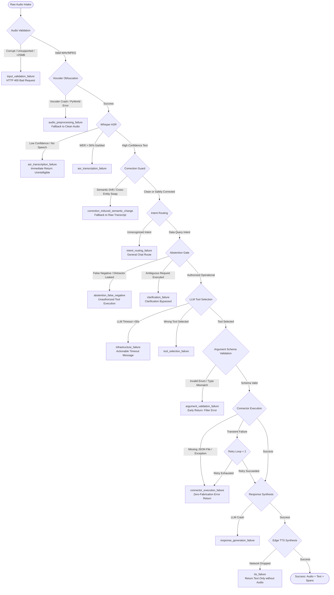

# Report 01 — System Inventory & Reconstructed Architecture

**Audit Document:** `reports/system_audit/01_SYSTEM_INVENTORY_AND_ARCHITECTURE.md`  
**HEAD Commit:** `5b20a3a`  
**Status:** Complete Forensic System Reconstruction  

---

## 1. Stage A — Source-of-Truth Inventory

Every module, entry point, route, and support script was inspected in the local working directory.

| Functional Area | Actual Files & Symbols | Evidence Found | Verification Status | Missing Evidence / Gaps |
|---|---|---|---|---|
| **Application Entry & Lifecycle** | `app/main.py:L1-L78` — `app`, `on_startup`, `serve_chat_ui`, `favicon`, exception handlers | FastAPI app instance, CORS middleware, lifespan events, route registrations. | `[VERIFIED]` | Graceful shutdown handler not implemented; `on_event("startup")` uses deprecated FastAPI syntax. |
| **Configuration & Secrets** | `app/config.py:L1-L105` — `Settings`, `get_settings` | Pydantic-settings class, `.env` file loading, validator for obfuscation strength and timeouts. | `[VERIFIED]` | Secrets rotation absent; default dev API key warning logged rather than halting execution. |
| **HTTP Routing (Voice)** | `app/routers/voice.py:L1-L476` — `voice_query`, `stream_audio`, `cleanup_session_audio` | Multipart form intake (`/voice/query`), audio validation, ephemeral audio storage, streaming audio response. | `[VERIFIED]` | Streaming chunking lacks backpressure control; session cleanup requires explicit client call or 1-hour cron. |
| **HTTP Routing (Evaluation)** | `app/routers/evaluation.py:L1-L302` — `list_datasets`, `list_runs`, `get_run_summary`, `serve_case_audio` | REST endpoints serving JSONL manifests, paired run summaries, and audio streaming for Evaluation Lab UI. | `[VERIFIED]` | Read-only endpoints; no endpoint exists to trigger evaluation runs asynchronously from the UI. |
| **HTTP Routing (Health)** | `app/routers/health.py:L1-L107` — `liveness`, `readiness`, `health_check` | Probe endpoints checking Whisper model load, Ollama HTTP ping, and connector data file existence. | `[VERIFIED]` | Readiness probe runs an actual TTS synthesis on every probe call, creating significant CPU overhead. |
| **Audio Validation** | `app/voice/audio_validation.py:L1-L72` — `validate_audio_upload`, `validate_audio_file` | File size limit (25 MB), duration check (120s), magic byte sniffing via `soundfile`/`librosa`. | `[VERIFIED]` | Audio sample rate normalization occurs in memory; no rejection of multichannel (>2 channel) audio. |
| **Voice Obfuscation** | `app/voice/obfuscator.py:L1-L268` — `VoiceObfuscator`, `FormantPreservingObfuscator` | WORLD vocoder (pyworld) analysis/synthesis, pitch semitone shift (Dio/Harvest), spectral envelope warping ($VTLN$). | `[VERIFIED]` | Concurrency hazard: shared temporary file path in legacy obfuscator; resolved in FormantPreserving instance by unique naming. |
| **Speech-to-Text (ASR)** | `app/voice/stt.py:L1-L74` — `STTEngine` | OpenAI Whisper (`small.en`), CPU execution, FP32 fallback, confidence heuristic calculation via segment logprobs. | `[VERIFIED]` | Single-threaded CPU execution; long utterances block the asyncio worker thread without process offloading. |
| **Transcript Correction** | `app/services/llm_orchestrator.py:L150-L248` — `correct_transcript` | LLM phonetic/domain correction pass, gated by `app/services/correction_guard.py:L1-L136` rules. | `[VERIFIED]` | Rejection heuristics rely on lexical overlap; subtle semantic drift without entity change can pass the gate. |
| **Intent Classification** | `app/services/intent_router.py:L1-L172` — `classify_intent`, `is_data_query` | Regex keyword heuristic routing across `CRM_QUERY`, `SUPPORT_QUERY`, `ANALYTICS_QUERY`, and `GENERAL_CONVERSATION`. | `[VERIFIED]` | Brittle keyword matching fails on linguistic variation, indirect requests, and complex syntactic negation. |
| **Selective Abstention** | `app/services/abstention_router.py:L1-L224` — `evaluate_abstention`, `Decision`, `AbstentionResult` | Confidence-gated routing: evaluates domain specificity and operational framing to abstain on out-of-domain queries. | `[VERIFIED]` | Critical coverage gap: fails on negation ("do not show"), hypotheticals ("what if"), and conversational mentions. |
| **Tool Orchestration** | `app/services/llm_orchestrator.py:L444-L901` — `LLMOrchestrator`, `process_query` | Ollama client chat integration (`llama3.2:latest`), tool schema definition, argument validation, multi-turn synthesis. | `[VERIFIED]` | Nondeterministic tool calling: local LLM occasionally produces invalid enum values, causing schema validation errors. |
| **Argument Validation** | `app/services/llm_orchestrator.py:L254-L350` — `_validate_args`, `_coerce_args` | In-process JSON schema validation, string-to-int type coercion, priority normalization. | `[VERIFIED]` | Rejection returns early error message; does not prompt LLM to self-correct invalid arguments. |
| **Domain Connectors** | `app/connectors/*.py` — `CRMConnector`, `SupportConnector`, `AnalyticsConnector` | In-memory JSON file readers (`data/customers.json`, `support_tickets.json`, `analytics.json`), query filtering. | `[VERIFIED]` | Pure read-only mock connectors; no persistent database or external API integrations implemented. |
| **Retry Subsystem** | `app/services/llm_orchestrator.py:L553-L570` | Bounded while-loop (max 2 retries) checking transient connector error strings (`timeout`, `locked`, `connection`). | `[VERIFIED]` | Only triggers on connector exceptions; does not retry LLM timeouts, schema errors, or ASR failures. |
| **Audio Storage & Lifecycle** | `app/voice/audio_store.py:L1-L109` — `EphemeralAudioStore` | In-memory session dictionary, disk-based temporary storage (`temp_audio/`), TTL expiration sweeps. | `[VERIFIED]` | Process-local memory store; state is lost on process restart; not shared across multiple workers. |
| **Text-to-Speech (TTS)** | `app/voice/tts.py:L1-L11` — `TTSEngine`, `edge_tts` | Microsoft Edge TTS async synthesis (`en-US-GuyNeural`), MP3 generation. | `[VERIFIED]` | Relies on external Microsoft cloud WebSocket; fails outright without internet connectivity. |
| **Frontend UI & Lab** | `voice_chat.html` / `app/voice_chat.html` | Vanilla HTML5/CSS3/JS, MediaRecorder audio capture, dual-tab (Live Assistant & Evaluation Lab). | `[VERIFIED]` | Evaluation Lab requires manual browser refresh if new evaluations are run in the background. |
| **Paired Evaluation Runner** | `evaluation/runners/run_paired_evaluation.py:L1-L542` — `PairedPipelineRunner` | Runs paired baseline vs abstention evaluations over audio datasets with cached STT, Wilson CIs, and metrics summary. | `[VERIFIED]` | CPU-intensive: full 38-case evaluation requires ~15 minutes on standard multi-core CPU. |

---

## 2. Stage B — Architecture Reconstruction

### 2.1 System Context Diagram

The system operates as a hybrid local/cloud edge service. Speech recognition, voice obfuscation, intent routing, and tool execution occur entirely locally, while TTS synthesis relies on Microsoft Edge TTS WebSockets.

```mermaid
flowchart TD
    User["👤 End User / Operator"]
    Browser["🌐 Web Browser (voice_chat.html)"]
    
    subgraph HostSystem ["🖥️ Local Host System (Privacy Boundary)"]
        subgraph FastAPIApp ["FastAPI Application (app.main:app)"]
            VoiceRouter["/voice/query Endpoint"]
            HealthRouter["/health Endpoints"]
            EvalRouter["/evaluation Endpoints"]
            AudioStore["EphemeralAudioStore (Memory / temp_audio)"]
        end
        
        subgraph VoiceSubsystem ["Voice Processing Pipeline"]
            Vocoder["WORLD Vocoder (FormantPreservingObfuscator)"]
            Whisper["Whisper small.en (CPU Speech-to-Text)"]
        end
        
        subgraph LogicSubsystem ["Decision & Orchestration Layer"]
            Guard["Correction Guard"]
            Router["Intent / Abstention Router"]
            Orchestrator["LLM Orchestrator (Schema Validation)"]
        end
        
        subgraph DataSubsystem ["Data & Storage Layer"]
            Connectors["Mock Connectors (CRM, Support, Analytics)"]
            DataFiles[("JSON Datasets (data/*.json)")]
        end
        
        subgraph LocalInference ["Local LLM Daemon"]
            Ollama["Ollama Server (llama3.2:latest @ :11434)"]
        end
    end
    
    subgraph ExternalCloud ["☁️ External Network"]
        EdgeTTS["Microsoft Edge TTS (WSS Service)"]
    end

    User -->|Microphone Audio / UI Actions| Browser
    Browser -->|HTTP POST /voice/query (Multipart Audio)| VoiceRouter
    Browser -->|HTTP GET /evaluation/*| EvalRouter
    Browser -->|HTTP GET /health/*| HealthRouter
    
    VoiceRouter --> AudioStore
    VoiceRouter --> Vocoder
    Vocoder --> Whisper
    Whisper --> Guard
    Guard --> Router
    Router --> Orchestrator
    Orchestrator <-->|HTTP POST /api/chat (Tool Calling)| Ollama
    Orchestrator --> Connectors
    Connectors --> DataFiles
    
    VoiceRouter -->|Synthesize Speech| EdgeTTS
    EdgeTTS -->|Audio Buffer| VoiceRouter
    VoiceRouter -->|JSON Response + Audio Path| Browser
```

---

### 2.2 Component Architecture Diagram

The internal dependency structure demonstrates modular separation between voice handling, decision routing, tool connectors, and evaluation harnesses.



---

### 2.3 Runtime Sequence Diagram: Successful Operational Request

The execution path for an unambiguous operational query (e.g. *"Show me active customers"*):



---

### 2.4 Runtime Sequence Diagram: Abstained Distractor Request

The execution path when an out-of-domain distractor query is safely intercepted:



---

### 2.5 Failure Path Diagram

Failure containment and error attribution across the 11 pipeline stages:



---

### 2.6 Data Flow Diagram

Flow of data artifacts, trust boundaries, and persistence lifecycles:

```mermaid
flowchart LR
    subgraph Client ["Client Device"]
        Mic["Microphone PCM"]
    end
    
    subgraph Intake ["Intake & Storage"]
        RawWav["temp_audio/*.wav<br/>(Ephemeral, TTL 3600s)"]
    end
    
    subgraph SpeechTransform ["Voice Processing"]
        ObfWav["tmp_obf_*.wav<br/>(Deleted immediately)"]
        Text["Raw Transcript String<br/>(In-Memory)"]
    end
    
    subgraph DecisionLayer ["Semantic Processing"]
        Prompt["System Prompt + Tools JSON<br/>(In-Memory)"]
        ToolCall["ToolCall Args Dictionary<br/>(Validated)"]
    end
    
    subgraph LocalDB ["Data Boundary"]
        MockDB[("data/*.json<br/>(Read-Only Disk Files)")]
        Result["Connector Result Records<br/>(Max 10 rows)"]
    end
    
    subgraph OutputLayer ["Output Generation"]
        RespText["Final Answer String"]
        RespAudio["temp_audio/resp_*.mp3<br/>(Ephemeral)"]
        Metadata["Structured Latency & Decision Metadata"]
    end

    Mic -->|HTTP POST| RawWav
    RawWav -->|Read PCM| ObfWav
    ObfWav -->|Wav Buffer| Text
    Text --> Prompt
    Prompt --> ToolCall
    ToolCall --> MockDB
    MockDB --> Result
    Result --> RespText
    RespText --> RespAudio
    RespText --> Metadata
```



---

## 3. Boundary & Execution Analysis

### 3.1 Synchronous vs. Asynchronous Execution
- **Asynchronous (`async def`):**
  - FastAPI request handling in `app/routers/voice.py:voice_query`.
  - Microsoft Edge TTS generation (`communicate.save()`).
  - Audio validation and disk I/O streaming.
- **Synchronous Bottlenecks (Blocking Event Loop):**
  - **Whisper STT (`model.transcribe`):** Executed synchronously on CPU inside the async request handler. This blocks the Python asyncio event loop for 1,500–6,000 ms per request, preventing concurrent request processing on single-worker deployments.
  - **WORLD Vocoder (`pyworld.cheaptrick`, `d4c`, `synthesize`):** CPU-bound numerical processing run synchronously on the event loop (latency: 500–4,000 ms).
  - **Ollama HTTP Client:** Synchronous blocking HTTP calls via `ollama.Client.chat()`.

### 3.2 Local vs. External Components
- **Strictly Local:**
  - Speech-to-text (Whisper running locally in memory).
  - Formant obfuscation (pyworld vocoder compiled in C/Python).
  - Intent routing and correction guard (in-process Python logic).
  - LLM inference (Ollama running locally on `http://127.0.0.1:11434`).
  - Data storage (local JSON files in `data/`).
- **External Network Dependencies:**
  - **Microsoft Edge TTS (`edge_tts`):** Connects to `wss://speech.platform.bing.com/consumer/create/edge/v1`. If external network connectivity is lost, TTS synthesis fails completely.

### 3.3 Model Boundaries
1. **Whisper ASR Boundary:** Acoustic waveforms cross into tokenized text transcripts. The boundary is lossy under noise or low acoustic energy, governed by `stt_conf["avg_logprob"]`.
2. **LLM Orchestration Boundary:** Text transcripts cross into structured tool call definitions. Governed by JSON Schema validation (`_validate_args`).

### 3.4 Trust & Security Boundaries
- **Untrusted Input:** Multipart audio uploaded by user (`/voice/query`). Sniffed via `soundfile` to prevent binary exploit payloads.
- **API Key Gate:** Handled via `validate_api_key`. In current default configuration, it falls back to an insecure development placeholder if unset.
- **Read-Only Data Isolation:** Connectors only read from disk; no dynamic SQL injection or remote code execution vectors exist in the mock storage layer.

### 3.5 Bypasses Around Intended Safeguards
- **Baseline Bypass:** Passing `enable_abstention=False` completely bypasses the abstention router, directly invoking the intent router and tool calling loop.
- **Correction Rejection Fallback:** If the correction LLM introduces an invalid entity swap, `validate_correction()` rejects the correction and silently falls back to the raw uncorrected transcript.
