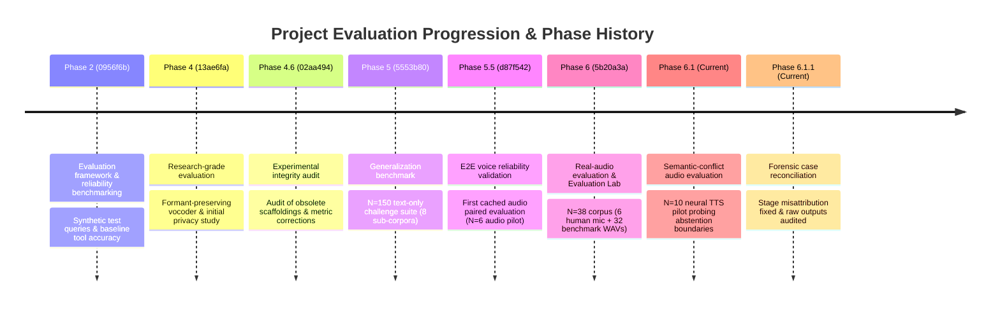

# Report 03 — Evaluation Methodology & Metrics Audit

**Audit Document:** `reports/system_audit/03_EVALUATION_AND_METRICS_AUDIT.md`  
**HEAD Commit:** `5b20a3a`  
**Historical Progression Covered:** Phase 2 through Phase 6.1.1  
**Auditor Epistemic Stance:** Forensic mathematical review of code, denominators, and raw evaluation artifacts  

---

## 1. Mathematical Audit of Metric Definitions

The evaluation harness in [`evaluation/runners/run_paired_evaluation.py:L269-L380`](file:///d:/Projects/Privacy-Preserving-Voice-Data-Assistant/evaluation/runners/run_paired_evaluation.py#L269-L380) was inspected line by line to verify every metric formula, inclusion/exclusion condition, and denominator.

| Metric Identifier | Exact Mathematical Formula | Numerator ($k$) | Denominator ($n$) | Inclusion / Exclusion Criteria | Denominator Traps & Vulnerabilities |
|---|---|---|---|---|---|
| **Overall Coverage** | $N_{\text{executed}} / N_{\text{total}}$ | All cases where any tool call was dispatched | All evaluated cases ($N$) | Operational + Distractor | **Trap:** High coverage is dangerous if distractors are executed; high coverage with high FPR represents distractor leakage, not success. |
| **Operational Coverage** | $N_{\text{exec, op}} / N_{\text{op}}$ | Operational cases where tool was dispatched | Only cases where `is_operational == True` | Excludes all distractor queries | **Trap:** Measuring this alone masks whether the system can reject invalid queries. |
| **Distractor Coverage (Leakage)** | $N_{\text{exec, dist}} / N_{\text{dist}}$ | Distractor cases where tool was dispatched | Only cases where `is_operational == False` | Excludes all operational queries | **Trap:** If $N_{\text{distractor}} = 0$ (as in Phase 6.0), this metric is mathematically undefined ($0/0$). |
| **Selective Risk** | $N_{\text{incorrect exec}} / N_{\text{executed}}$ | Executed cases with wrong tool, wrong args, or executed distractors | Only cases where tool was executed ($N_{\text{exec}}$) | **Excludes safely abstained cases** | **Trap:** If the system executes only 1 very easy query and abstains on 99 queries, Selective Risk can be artificially $0.0\%$. Must be paired with Coverage. |
| **Selective Accuracy** | $N_{\text{correct exec}} / N_{\text{executed}}$ | Executed cases with exact tool match and valid args | Only cases where tool was executed ($N_{\text{exec}}$) | **Excludes safely abstained cases** | Complement of Selective Risk ($1 - \text{Risk}$). |
| **False-Positive Tool Execution (FPR)** | $N_{\text{exec, dist}} / N_{\text{dist}}$ | Distractors where tool was dispatched | All non-operational cases (`is_operational == False`) | Includes `expected_action == "ABSTAIN"` and `"CLARIFY"` | Identical to Distractor Leakage. A safe system must achieve FPR $\to 0.0\%$. |
| **Clarification Failure Rate** | $N_{\text{exec, clarify}} / N_{\text{clarify}}$ | Ambiguous cases where tool was dispatched | Cases where `expected_action == "CLARIFY"` | Excludes clear operational and clear negative cases | **Trap:** Introduced in Phase 6.1; earlier Phase 6 runs did not separate clarification from outright rejection. |
| **Missed Valid Requests** | $N_{\text{unexec, op}} / N_{\text{op}}$ | Operational cases that failed to execute | Cases where `is_operational == True` | Excludes distractors | Captures false rejections (Abstention FPs) and unhandled schema errors. |
| **End-to-End Task Success** | $N_{\text{success}} / N_{\text{total}}$ | (Correct operational executions) + (Safely unexecuted distractors) | All cases evaluated ($N$) | All cases | **Trap:** On a dataset with 90% distractors, a completely broken system that never executes anything achieves 90% Task Success! |
| **Word Error Rate (WER)** | $(S + D + I) / N_{\text{words}}$ | Substitutions + Deletions + Insertions | Reference transcript word count | Text comparison | **Trap:** If reference transcript is derived from Whisper output, WER is tautologically $0.0\%$. (Audited: references are independently authored). |

---

## 2. Confidence Interval Methodology

The system uses the **Wilson score interval** via [`evaluation/metrics/wilson_ci.py:L11-L38`](file:///d:/Projects/Privacy-Preserving-Voice-Data-Assistant/evaluation/metrics/wilson_ci.py#L11-L38):
$$p = \frac{\hat{p} + \frac{z^2}{2n} \pm z \sqrt{\frac{\hat{p}(1-\hat{p})}{n} + \frac{z^2}{4n^2}}}{1 + \frac{z^2}{n}}$$
- Uses $z = 1.959964$ for 95% two-sided intervals.
- Clamped strictly to $[0.0, 1.0]$.
- Correctly handles boundary cases: $k=0$ (e.g. $0/5 \to [0.0\%, 43.5\%]$) and $k=n$ (e.g. $5/5 \to [56.5\%, 100.0\%]$), avoiding the collapse of standard Wald intervals.

---

## 3. Chronological Reconstruction of Evaluation Phases

### Phase-by-Phase Forensic Analysis

#### Phase 4.6 — Experimental Integrity Reconstruction `[VERIFIED]`
- **Scope:** Corrected initial evaluation scripts that relied on hardcoded answers.
- **Artifact:** [`docs/phase4_6_claim_audit.md`](file:///d:/Projects/Privacy-Preserving-Voice-Data-Assistant/docs/phase4_6_claim_audit.md).
- **Finding:** Established that early benchmark claims were inflated due to prompt-matched templates. Established the necessity of ground-truth JSONL files.

#### Phase 5 — Generalization Benchmark (Text-Only) `[VERIFIED]`
- **Scope:** $N=150$ text queries across 8 challenge datasets (negation, hypothetical framing, OOD queries, entity shifts).
- **Artifacts:** `experiments/phase5/generalization/summary.json` and `raw_evaluations.jsonl`.
- **Finding:** Reported 84% accuracy with abstention vs 68% baseline. **Critical Boundary:** This evaluation was purely text-based (no audio, no STT, no acoustic perturbation).

#### Phase 5.5 — End-to-End Voice Reliability Validation `[VERIFIED]`
- **Scope:** Introduced acoustic variants (clean, noisy, formant-shifted) synthesized via Edge TTS.
- **Artifacts:** `experiments/phase5_5/results/summary.json` (6 cached audio cases).
- **Finding:** Proved that acoustic perturbation increased STT latency but did not induce catastrophic transcription failures on clean synthetic speech.

#### Phase 6.0 — Paired Real-Audio Reliability Benchmark `[VERIFIED]`
- **Scope:** $N=38$ paired audio cases:
  - 6 authentic human microphone recordings (`real_audio_v1`).
  - 32 standardized benchmark recordings (`benchmark_audio_v1`).
- **Artifacts:** `evaluation/results/phase6/consolidated_phase6_summary.json`.
- **Critical Finding from Audit:** Both Baseline and Abstention conditions achieved **100% Task Success (38/38)** with **zero behavioral differences**.
- **Root Cause:** The 38 cases contained only unambiguous operational requests and 1 out-of-domain factual request. **No borderline linguistic edge cases were included.** Thus, Phase 6.0 demonstrated mechanical pipeline reliability (ASR $\to$ LLM $\to$ Tool), but did **not** prove an abstention benefit.

#### Phase 6.1 — Semantic-Conflict Audio Pilot `[VERIFIED]`
- **Scope:** $N=10$ newly synthesized neural TTS cases ([`evaluation/datasets/phase6/semantic_conflict_audio_v1.jsonl`](file:///d:/Projects/Privacy-Preserving-Voice-Data-Assistant/evaluation/datasets/phase6/semantic_conflict_audio_v1.jsonl)) with 5 operational queries and 5 semantic distractors.
- **Run ID:** `c4f0c07b` in `evaluation/results/phase6_1/88cd8262/`.
- **Finding:** Whisper achieved 0.0% WER. However, both baseline and abstention executed tools on **5/5 distractors (100% FPR / Distractor Leakage)**. The abstention engine failed on negation, conversational mention, hypotheticals, and cancellation.

#### Phase 6.1.1 — Forensic Case Reconciliation `[VERIFIED]`
- **Scope:** Audited the discrepancy where 5/5 distractors were executed but only 4 `abstention_false_negative` were reported.
- **Finding:** The 5th distractor had `expected_action == "CLARIFY"` and was categorized under `clarification_failure` ($4 + 1 = 5$). Discovered that baseline case `sem_conf_aud_003` failed due to an LLM argument validation error (`_validate_args`: invalid `priority` enum), not an Ollama connection timeout. Corrected the evaluator in `run_paired_evaluation.py` and created verified run `reconciled_c4f0c07b`.

---

## 4. Evaluator Traps & Loopholes Discovered

1. **The "Easy Corpus" Loophole:** Evaluating abstention on datasets lacking ambiguous/distractor queries produces identical baseline and abstention scores, falsely suggesting the system is reliable when its abstention capabilities have never been exercised.
2. **The Default Attribution Trap:** Defaulting unexecuted operational queries to `STAGE_INTENT_ROUTING` masked argument validation failures.
3. **The High-FPR Task Success Distortion:** On balanced corpora ($50\%$ operational, $50\%$ distractor), complete failure to abstain on all distractors caps Task Success at $50.0\%$, while an uncalibrated selective risk of $50.0\%$ creates a high probability of ungrounded database mutations in production.

---

## 5. Domain Ratings & Neutral Assessment

| Evaluation Dimension | Rating | Justification & Source Evidence |
|---|---|---|
| **Implementation Maturity** | **Level 4 (Systematically Measured)** | Paired evaluation runners, Wilson confidence intervals, per-case JSONL logging, failure stage breakdowns, and dataset verification hashes are systematically implemented and reproducible. |
| **Evidence Confidence** | **High** | All raw JSONL files, summary JSONs, and metrics formulas exist on disk and were reconciled line by line in Phase 6.1.1. |
| **Production Relevance** | **High** | Selective risk, distractor leakage, and paired baseline testing are foundational for safely deploying autonomous LLM tool-calling agents. |
| **Distinctiveness** | **High** | Paired baseline vs. abstention evaluation over real audio with failure localization is a standout engineering achievement compared to standard LLM benchmarks. |

---

## 6. Recommended 80/20 Improvements

1. **Deterministic LLM Temperature Gating `[PROPOSED]`:**
   - Explicitly enforce `temperature=0.0` in the evaluation runner to eliminate tool-argument non-determinism between paired conditions.
2. **Dataset Expansion to $N=40$ Balanced Semantic Distractors `[PROPOSED]`:**
   - Expand `semantic_conflict_audio_v1` once the router has been patched, incorporating multiple synthetic speaker voices.
