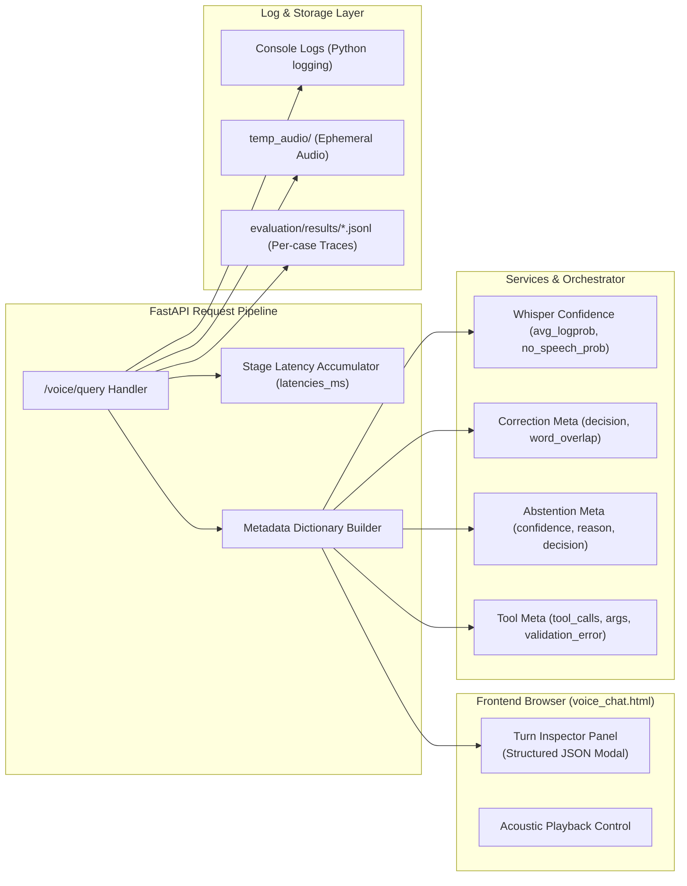

# Report 04 — Observability, Tracing & Debuggability Audit

**Audit Document:** `reports/system_audit/04_OBSERVABILITY_AND_DEBUGGABILITY_AUDIT.md`  
**HEAD Commit:** `5b20a3a`  
**Status:** Complete Forensic Telemetry & Observability Review  

---

## 1. Concept Definition & AI Systems Importance

In classical web services, observability tracks HTTP status codes, latency percentiles, and database query durations. In **Voice AI Systems**, observability must trace cross-modal signal transformations:
$$\text{Acoustic Audio} \xrightarrow{\text{Obfuscation}} \text{Warped Audio} \xrightarrow{\text{ASR}} \text{Tokens} \xrightarrow{\text{Correction}} \text{Text} \xrightarrow{\text{Router}} \text{Intent} \xrightarrow{\text{LLM}} \text{Structured Tool Calls} \xrightarrow{\text{Connector}} \text{Data}$$
If a failure occurs, the telemetry must localize whether the defect arose from acoustic distortion, transcription hallucination, semantic misunderstanding, invalid argument formatting, or backend timeout.

---

## 2. Telemetry Architecture & Implementation Evidence

### 2.1 Latency Spans & Timing Breakdown `[VERIFIED]`
Inspected in [`app/routers/voice.py:L310-L460`](file:///d:/Projects/Privacy-Preserving-Voice-Data-Assistant/app/routers/voice.py#L310-L460) and [`app/services/llm_orchestrator.py:L670-L750`](file:///d:/Projects/Privacy-Preserving-Voice-Data-Assistant/app/services/llm_orchestrator.py#L670-L750). Every response metadata payload contains millisecond-level spans:
- `validation_ms`: Audio header and format validation time.
- `obfuscation_ms`: WORLD vocoder pitch shifting and spectral warping duration.
- `stt_ms`: Whisper transcription time.
- `correction_latency_ms`: LLM transcript correction pass duration.
- `routing_latency_ms`: Intent routing / abstention decision latency.
- `abstention_latency_ms`: Confidence evaluation latency.
- `tool_latency_ms`: Ollama tool-calling chat latency.
- `tts_latency_ms`: Edge-TTS audio generation latency.
- `total_ms`: End-to-end pipeline latency.

### 2.2 Error Taxonomy (`app/failure.py`) `[VERIFIED]`
Inspected in [`app/failure.py:L1-L62`](file:///d:/Projects/Privacy-Preserving-Voice-Data-Assistant/app/failure.py#L1-L62). The system defines an explicit `FailureType` enum:
- `INPUT_VALIDATION_ERROR` (HTTP 400)
- `AUDIO_DECODE_ERROR` (HTTP 400)
- `AUDIO_TOO_LARGE` (HTTP 413)
- `AUDIO_TOO_LONG` (HTTP 400)
- `UNAUTHORIZED` (HTTP 401)
- `UNSUPPORTED_MEDIA_TYPE` (HTTP 415)
- `PIPELINE_ERROR` (HTTP 500)
- `INTERNAL_ERROR` (HTTP 500)

### 2.3 Turn Inspector in Web UI (`voice_chat.html`) `[VERIFIED]`
Inspected in [`voice_chat.html:L1130-L1240`](file:///d:/Projects/Privacy-Preserving-Voice-Data-Assistant/voice_chat.html#L1130-L1240). The web frontend features an interactive **Turn Inspector** that displays:
- Raw Whisper transcript vs corrected transcript.
- STT confidence score (`avg_logprob`, `no_speech_prob`).
- Abstention decision, confidence rating, and explanatory reason.
- Executed tool name, input arguments, and raw connector outputs.
- Collapsible matched records dropdown showing cross-domain entities.
- Full timing waterfall breakdown across all 7 stages.

---

## 3. Forensic Reconstructibility of Failed Requests

We assessed whether a production incident or failed evaluation request can be fully reconstructed from its recorded artifacts:

| Forensic Question | Can the Current System Answer It? | Exact Source of Truth / Evidence |
|---|---|---|
| **What happened?** | **YES** | `answer_text` and HTTP response body provide the user-visible outcome. |
| **Where did it fail?** | **YES** | `primary_failure_stage` in evaluation JSONL; `failure_type` and `validation_error` in API metadata. |
| **Why did it fail?** | **YES** | Recorded in `abstention_reason` (if rejected) or `validation_error` (if schema mismatch) or `connector_error`. |
| **Which model / prompt was used?** | **PARTIALLY** | Model name is recorded (`OLLAMA_MODEL: llama3.2:latest`, `STT_MODEL: small.en`), but exact prompt template Git hash is not embedded in the trace. |
| **Was the result non-deterministic?** | **NO** | Temperature and seed are not recorded in request metadata; re-running the same text may yield different results. |
| **Did a retry change the outcome?** | **YES** | Tracked via `retry_attempted: bool`, `retry_count: int`, and `retry_succeeded: bool` in orchestrator metadata. |
| **Was user's original input preserved?** | **YES** | Raw audio is held in `temp_audio/` (TTL 3600s); raw transcript is stored in `metadata.raw_transcript`. |
| **Is the trace safe to retain?** | **PARTIALLY** | If `LOG_TRANSCRIPTS=False`, transcripts are excluded from server stdout, but metadata returned to client contains full text. |

---

## 4. Observability Gaps & Anti-Patterns

1. **No OpenTelemetry / Distributed Tracing `[NOT IMPLEMENTED]`:** The system uses in-process Python dictionaries for latencies rather than W3C standard traceparent headers or OpenTelemetry spans. Traces cannot be exported to Jaeger, Datadog, or Grafana Tempo.
2. **Missing Unique Correlation ID on Client Requests `[PARTIALLY VERIFIED]`:** While `EphemeralAudioStore` generates a `session_id`, individual `/voice/query` requests do not accept or return an `X-Request-ID` header to correlate client logs with backend logs.
3. **Unstructured Stdout Logs `[VERIFIED]`:** Server logging relies on standard Python `logging.getLogger(__name__)` outputting unstructured text strings rather than structured JSON logs (NDJSON).

---

## 5. Domain Ratings & Neutral Assessment

| Evaluation Dimension | Rating | Justification & Source Evidence |
|---|---|---|
| **Implementation Maturity** | **Level 3 (Tested Implementation)** | The Turn Inspector and stage latency breakdown (`latencies_ms`) provide rich localized debugging. It does not reach Level 4 because continuous telemetry aggregation (e.g. Prometheus metrics exporter) is absent. |
| **Evidence Confidence** | **High** | Metadata schemas and UI inspector logic verified directly in `app/routers/voice.py`, `app/services/llm_orchestrator.py`, and `voice_chat.html`. |
| **Production Relevance** | **High** | Having stage-level latency spans and failure stage attribution is essential for pinpointing multi-model voice pipeline latency. |
| **Distinctiveness** | **High** | The browser-based Turn Inspector displaying multi-stage latencies, abstention confidence, and tool execution traces is exceptionally rare in portfolio projects. |

---

## 6. Recommended 80/20 Improvements

1. **Inject `X-Request-ID` Header Middleware `[PROPOSED]`:**
   - **Action:** Add FastAPI middleware generating a UUID4 `request_id` per turn, attaching it to all log messages and response headers.
   - **Effort:** 45 minutes.
   - **Impact:** High. Enables instant log correlation for debugging.
2. **JSON Structured Logging `[PROPOSED]`:**
   - **Action:** Replace standard logger formatting with a lightweight JSON formatter emitting `timestamp`, `request_id`, `stage`, `latency_ms`, and `error`.
   - **Effort:** 1 hour.
   - **Impact:** High. Prepares the service for Grafana Loki or AWS CloudWatch ingestion.
