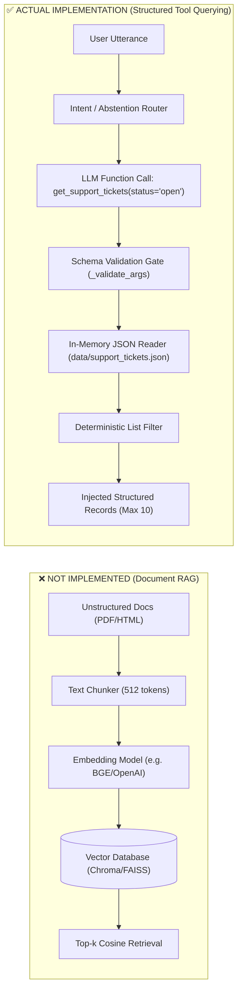

# Report 07 — RAG, Retrieval & Grounding Audit

**Audit Document:** `reports/system_audit/07_RAG_RETRIEVAL_AND_GROUNDING_AUDIT.md`  
**HEAD Commit:** `5b20a3a`  
**Status:** Forensic Retrieval System Audit & RAG Disambiguation  
**Auditor Finding:** **RAG IS NOT IMPLEMENTED IN THIS REPOSITORY.**  

---

## 1. Direct Finding: Absence of RAG in the Local Repository

A systematic search across the local codebase, dependencies, and configuration confirmed:
- **Vector Databases:** `chromadb`, `faiss`, `qdrant`, `weaviate`, and `pinecone` are **ABSENT** from `requirements.txt` and source files.
- **Embedding Models:** No sentence-transformers, OpenAI embeddings, or Ollama embedding endpoints are invoked.
- **Document Ingestion & Chunking:** No PDF, Markdown, HTML, or text chunking pipelines exist.
- **Dense / Hybrid Retrieval:** No dense vector search, BM25 lexical index, or reranking models exist.

### Epistemic Status: `[NOT IMPLEMENTED]`
The system is **NOT** a Retrieval-Augmented Generation (RAG) system. Any claim that this project implements RAG is factually incorrect based on the repository source of truth.

---

## 2. Disambiguation: What the System Actually Implements

In contemporary AI discussions, any interaction between an LLM and external data is often casually mislabeled as "RAG." The table below provides a rigorous technical disambiguation:

| Architecture Pattern | Technical Definition | Does This Project Implement It? | Actual Implementation in Repository |
|---|---|---|---|
| **Document RAG** | Chunking unstructured documents, embedding into vector space, similarity search, top-$k$ context injection into prompts. | **NO (Absent)** | None. No document indices exist. |
| **Structured Tool / Connector Querying** | LLM outputs typed function arguments (`{"status": "open"}`) passed to deterministic Python functions filtering tabular/JSON records. | **YES (Implemented)** | `app/connectors/*.py` (`CRMConnector`, `SupportConnector`, `AnalyticsConnector`). |
| **Database Querying** | Executing SQL/NoSQL queries against a relational database management system. | **NO (Mocked)** | Reads static JSON files from `data/` using in-memory Python list comprehensions. |
| **Conversational Memory** | Multi-turn conversational buffer, summarization, or sliding window history across turns. | **PARTIALLY (Ephemeral)** | `EphemeralAudioStore` tracks session turns within a single session, but LLM chat history is not maintained across separate queries. |
| **Grounding / Zero-Fabrication** | Constraining LLM responses strictly to verified connector outputs without extrapolation. | **YES (Implemented)** | Orchestrator injects exact connector records into LLM user prompt; halts on connector error (`L572`). |



---

## 3. Grounding & Zero-Fabrication Properties

Although RAG is absent, the system implements sound **Structured Grounding** invariants:
1. **Deterministic Data Retrieval:** Connectors do not use vector similarity; they use strict equality checks (`record.get("status") == status`). This eliminates semantic retrieval hallucination.
2. **Context Window Constraint:** The orchestrator limits returned records to `MAX_RESULTS = 10` (clamped in `_coerce_args`) to prevent context window overflow in `llama3.2:latest`.
3. **Connector Error Trapping:** If data files cannot be loaded, the orchestrator returns the raw error string to the user rather than passing an empty list to the LLM, preventing the LLM from hallucinating answers to unanswerable queries.

---

## 4. Proposed Architecture for a Future Document RAG Subsystem

If the project owner chooses to expand the assistant to answer unstructured business policy questions (e.g. *"What is our refund policy for inactive customers?"*), a bounded RAG subsystem should be implemented as a dedicated tool:

### 4.1 Bounded RAG Architecture Specification `[PROPOSED]`
- **Tool Name:** `search_knowledge_base(query: str, category: Optional[str] = None)`
- **Document Store:** Markdown knowledge base articles in `data/knowledge_base/`.
- **Chunking:** Semantic paragraph chunking (300–500 tokens, 50-token overlap).
- **Embedding:** Local CPU-efficient embedding model via Ollama (`nomic-embed-text` or `all-minilm-l6-v2`).
- **Vector Store:** Local embedded `chromadb` or SQLite with `sqlite-vss` (zero external network dependency).
- **Hybrid Retrieval:** Dense cosine similarity combined with BM25 keyword matching (Reciprocal Rank Fusion).

### 4.2 Relevant vs. Irrelevant Retrieval Metrics

```
+-------------------------------------------------------------------------------+
| Metric                      | Relevance to this Project | Justification       |
+-------------------------------------------------------------------------------+
| 1. Context Recall@k         | ESSENTIAL                 | Did retrieval fetch |
|                             |                           | the policy section? |
| 2. Answer Faithfulness      | ESSENTIAL                 | Did LLM stick to    |
|                             |                           | retrieved text?     |
| 3. Insufficient Evidence    | CRITICAL (Core Theme)     | Did system abstain  |
|    Abstention Rate          |                           | when doc is missing?|
| 4. Context Precision        | HIGH                      | Are top chunks      |
|                             |                           | signal or noise?    |
| 5. nDCG@100                 | UNNECESSARY OVERKILL      | Dataset has <50     |
|                             |                           | policy documents    |
| 6. Cross-Encoder Reranker   | PREMATURE OPTIMIZATION    | High CPU latency on |
|    Latency Penalty          |                           | local host machine  |
+-------------------------------------------------------------------------------+
```

---

## 5. Domain Ratings & Neutral Assessment

| Evaluation Dimension | Rating | Justification & Source Evidence |
|---|---|---|
| **Implementation Maturity** | **Level 0 (Absent)** | Document RAG does not exist in code, configuration, or dependencies. |
| **Evidence Confidence** | **High** | Confirmed by direct dependency audit (`requirements.txt`), AST inspection of all `app/` modules, and dataset inventory. |
| **Production Relevance** | **Low (for current scope)** | For structured business databases (CRM, tickets, metrics), deterministic function calling is superior to RAG because it avoids vector hallucination. RAG is only relevant if unstructured documents are introduced. |
| **Distinctiveness** | **N/A** | Being honest about the absence of RAG is a strong positive signal of engineering integrity. |

---

## 6. Recommended 80/20 Improvements

1. **Clarify Portfolio Positioning `[PROPOSED]`:**
   - **Action:** Explicitly describe the system as an **"Autonomous Voice Agent with Structured Tool Calling and Selective Abstention"**, NOT a RAG system.
   - **Impact:** High. Eliminates immediate skepticism from experienced AI interviewers.
2. **Do Not Implement RAG Yet `[PROPOSED]`:**
   - **Action:** Focus engineering effort on repairing the semantic abstention router and adding CI tests before introducing vector databases.
