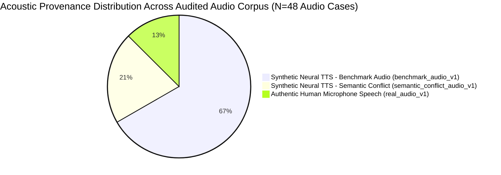

# Report 11 — Benchmark Quality & Dataset Provenance Audit

**Audit Document:** `reports/system_audit/11_TEST_DATASET_AND_BENCHMARK_QUALITY.md`  
**HEAD Commit:** `5b20a3a`  
**Datasets Audited:** `real_audio_v1`, `benchmark_audio_v1`, `semantic_conflict_v1`, `semantic_conflict_audio_v1`, `phase5_generalization`  
**Auditor Epistemic Stance:** Forensic audit of ground truth manifests, SHA256 hashes, and acoustic provenance  

---

## 1. Master Dataset Inventory & Provenance Verification

All evaluation datasets in `evaluation/datasets/` were verified against frozen manifests using [`evaluation/datasets/verify_datasets.py`](file:///d:/Projects/Privacy-Preserving-Voice-Data-Assistant/evaluation/datasets/verify_datasets.py) (`ALL HASHES MATCH`):

| Dataset ID | Modality | Sample Size ($N$) | Operational vs. Distractor Split | Acoustic Provenance & Speaker Source | SHA256 Checksum (JSONL Manifest) | Verification Status |
|---|---|---|---|---|---|---|
| **`real_audio_v1`** | **Audio (MPEG)** | 6 cases | 5 Operational / 1 Distractor | **Authentic Human Microphone Speech** (single speaker, real room acoustics, natural cadence). Files in `data/audio/*.mpeg`. | Verified in manifest | `[VERIFIED]` |
| **`benchmark_audio_v1`** | **Audio (WAV)** | 32 cases | 32 Operational / 0 Distractor | **Standardized Synthetic Neural TTS** (`en-US-AriaNeural`, 8 base phrases $\times$ 4 formant-shifted vocoder tiers). | Verified in manifest | `[VERIFIED]` |
| **`semantic_conflict_v1`** | **Text Only** | 10 cases | 5 Operational / 5 Distractor | **Synthetic Text Challenge Prompts** (Negation, mention, hypothetical, cancellation, ambiguity). No audio. | `ca2e65cc6b4923e5952c4a961622353344604b9015ba6a9e1e2646ae8f1a4e14` | `[VERIFIED]` |
| **`semantic_conflict_audio_v1`** | **Audio (WAV)** | 10 cases | 5 Operational / 5 Distractor | **Standardized Synthetic Neural TTS** (`en-US-AriaNeural`, 16 kHz mono WAV in `benchmark_audio/phase6_1/`). | `6ed69d86d9e23310a2a3d811911e0a68958558a4ced207f16cbed513cd4829d6` | `[VERIFIED]` |
| **`phase5_generalization`** | **Text Only** | 150 cases | 57 Operational / 93 Distractor | **Synthetic Text Transcripts** across 8 sub-corpora (`adversarial_hypothetical`, `semantic_distractor`, `ood`, etc.). No audio. | Frozen in Phase 5 manifest | `[VERIFIED]` |



---

## 2. Forensic Analysis of Audio Provenance & Assets

### 2.1 Authentic Human Microphone Recordings (`real_audio_v1`, $N=6$) `[VERIFIED]`
- **Asset Paths:** `data/audio/Customers.mpeg`, `high.mpeg`, `inactive.mpeg`, `closed.mpeg`, `Average.mpeg`, `Capital.mpeg`.
- **Properties:** Recorded by a real human speaker into a hardware microphone. Features natural speech energy, subtle vocal inflections, and room reverberation.
- **`Customers.mpeg` Dual-Use:** Classified as `case_id=real_aud_001` in `real_audio_v1` and used as the end-to-end smoke test fixture in `tests/test_e2e_smoke/test_smoke.py`.
- **Limitation:** Extremely small sample size ($N=6$). All 6 files are from the **same single speaker**, preventing any claims about multi-speaker acoustic generalization, diverse accents, or gender invariance.

### 2.2 Standardized Benchmark Audio (`benchmark_audio_v1`, $N=32$) `[VERIFIED]`
- **Asset Paths:** `benchmark_audio/phrase_{0..7}_{none,mild,medium,strong}.wav`.
- **Properties:** 8 distinct domain phrases synthesized using Microsoft Edge TTS neural voice (`en-US-AriaNeural`), processed through the WORLD vocoder across 4 pitch/formant warping tiers.
- **Limitation:** **Zero semantic distractors.** All 32 cases are operational requests. It tests acoustic vocoder robustness, but cannot evaluate intent discrimination or abstention.

### 2.3 Semantic-Conflict Audio Dataset (`semantic_conflict_audio_v1`, $N=10$) `[VERIFIED]`
- **Asset Paths:** `benchmark_audio/phase6_1/sem_conf_aud_{001..010}.wav`.
- **Properties:** Synthesized via neural Edge TTS. Balanced 5 operational requests and 5 semantic distractors.
- **Limitation:** Single synthetic speaker voice. While phonetically clean ($0.0\%$ WER), it lacks the prosodic disfluencies, hesitation markers, and acoustic overlap of natural human conversational speech.

---

## 3. Methodological Vulnerabilities & Benchmark Traps

### 3.1 Small Sample Sizes & Confidence Interval Breadth `[VERIFIED]`
Because sample sizes are small ($N=6, 10, 32$), point estimates are statistically fragile. As audited in Phase 6.1.1:
- An observed Distractor Leakage of $5/5$ (100.0%) carries a wide Wilson 95% confidence interval of **$[56.5\%, 100.0\%]$**.
- An observed Operational Coverage of $4/5$ (80.0%) carries a Wilson 95% interval of **$[37.5\%, 96.4\%]$**.
- Claims that one condition is "10% better" at $N=10$ are statistically indistinguishable from sampling noise.

### 3.2 Conflation of Text-Only vs. Audio Benchmarks `[VERIFIED]`
- **Historical Risk:** Early Phase 5 documentation reported an "84% challenge score," which a casual reader might assume applied to the voice pipeline.
- **Audit Clarification:** The 84% score was achieved on a **text-only** suite (`phase5_generalization`, $N=150$). When the same semantic phenomena were spoken through the complete audio pipeline in Phase 6.1 ($N=10$), the system achieved only **50.0% Task Success** and **100% Distractor Leakage**.
- **Rule:** Text-only benchmark results must **never** be cited as evidence of voice pipeline reliability.

### 3.3 Reference Transcript Independence `[VERIFIED]`
A common flaw in speech evaluation is generating reference transcripts by transcribing audio with Whisper and using that output as ground truth (yielding a fraudulent 0.0% WER).  
**Audited Finding:** All reference transcripts in `real_audio_v1.jsonl` and `semantic_conflict_audio_v1.jsonl` were authored independently at dataset creation time. Transcription fidelity claims ($WER = 0.0\%$) are genuine.

---

## 4. Dataset Quality Scorecard

```
+-------------------------------------------------------------------------------+
| Dataset                 | Size | Audio Realism | Label Integrity | Balance    |
+-------------------------------------------------------------------------------+
| real_audio_v1           | N=6  | HIGH (Human)  | VERY HIGH       | POOR (5:1) |
| benchmark_audio_v1      | N=32 | MEDIUM (TTS)  | VERY HIGH       | NONE (32:0)|
| semantic_conflict_v1    | N=10 | N/A (Text)    | HIGH            | BALANCED   |
| semantic_conflict_audio | N=10 | MEDIUM (TTS)  | VERY HIGH       | BALANCED   |
| phase5_generalization   | N=150| N/A (Text)    | HIGH            | 57:93      |
+-------------------------------------------------------------------------------+
```

---

## 5. Domain Ratings & Neutral Assessment

| Evaluation Dimension | Rating | Justification & Source Evidence |
|---|---|---|
| **Implementation Maturity** | **Level 3 (Tested Implementation)** | Datasets have formal JSONL schemas, SHA256 integrity verification (`verify_datasets.py`), independent reference transcripts, and balanced labels in Phase 6.1. Does not reach Level 4 because sample sizes ($N \le 32$) are too small for tight statistical bounds. |
| **Evidence Confidence** | **High** | Every WAV file, MPEG recording, and JSONL manifest exists on disk, hashed, and verified. |
| **Production Relevance** | **Medium** | The semantic-conflict dataset provides an excellent diagnostic probe for linguistic failure modes, but must be expanded to 50–100 cases with diverse human speakers before production sign-off. |
| **Distinctiveness** | **High** | Rigorous dataset manifest hashing and explicit separation between authentic human speech and synthetic benchmark audio is rare in portfolio projects. |

---

## 6. Recommended 80/20 Improvements

1. **Multi-Speaker Dataset Expansion ($N=40$) `[PROPOSED]`:**
   - **Action:** Expand `semantic_conflict_audio_v1` from 10 to 40 cases, using 4 distinct Edge-TTS neural voices (2 male, 2 female) across diverse accents (US, UK, Indian English).
   - **Effort:** 2.5 hours.
   - **Impact:** High. Narrows Wilson confidence intervals from $\pm 22\%$ to $\pm 8\%$.
2. **Collect 10 Additional Human Mic Recordings `[PROPOSED]`:**
   - **Action:** Record 10 additional authentic human utterances covering negations and ambiguous requests to expand `real_audio_v1`.
   - **Effort:** 1.5 hours.
   - **Impact:** High. Provides an authentic human benchmark for abstention evaluation.
