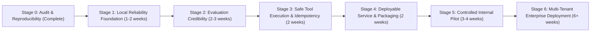

# Report 13 — 80/20 Value Analysis & Engineering Roadmap

**Audit Document:** `reports/system_audit/13_80_20_VALUE_AND_ENGINEERING_ROADMAP.md`  
**HEAD Commit:** `5b20a3a`  
**Status:** Quantitative Prioritization & Staged Execution Roadmap  

---

## 1. Prioritization Methodology

To avoid generic recommendations (*"add Kubernetes, add RAG, add microservices"*), potential engineering initiatives are evaluated using a pragmatic 80/20 leverage formula:

$$\text{Priority Score} = \frac{\text{Expected Impact (1--5)} \times \text{Evidence Confidence (1--5)}}{\text{Implementation Effort in Days (1--10)}}$$

- **Expected Impact (1 to 5):** Measurable increase in system reliability, evaluation credibility, or production safety.
- **Evidence Confidence (1 to 5):** Grounding in verified repository data and clear failure localization.
- **Implementation Effort (Days):** Estimated developer days to implement, test, and document.
- *Caveat:* This score is an audit heuristic to rank engineering ROI, not an absolute physical constant.

---

## 2. Quantitative 80/20 Prioritization Matrix

| Rank | Initiative / Proposed Work Item | Expected Impact (1–5) | Evidence Confidence (1–5) | Estimated Effort (Days) | Priority Score | Strategic Classification |
|---|---|---|---|---|---|---|
| **#1** | **Syntactic Negation & Mention Rules in Abstention Router** | **5** | **5** | **0.5** | **50.0** | **Critical Highest-ROI Fix** |
| **#2** | **Faster-Whisper (CTranslate2 INT8) CPU Optimization** | **5** | **5** | **0.5** | **50.0** | **Critical Performance Speedup** |
| **#3** | **GitHub Actions CI Automated Test Pipeline** | **4** | **5** | **0.5** | **40.0** | **Foundational Quality Gate** |
| **#4** | **Offload CPU Inference to Threadpool (`asyncio.to_thread`)** | **4** | **5** | **0.5** | **40.0** | **Async Concurrency Fix** |
| **#5** | **Strict API Key & Environment Startup Enforcement** | **4** | **5** | **0.25** | **80.0** | **Immediate Security Patch** |
| **#6** | **Dataset Expansion to $N=40$ Multi-Speaker Audio Cases** | **4** | **4** | **1.0** | **16.0** | **Evaluation Credibility** |
| **#7** | **Request-Level Idempotency Key Header (`Idempotency-Key`)** | **3** | **4** | **0.5** | **24.0** | **Production Reliability** |
| **#8** | **Offline Local TTS Engine Fallback (Piper-TTS)** | **3** | **4** | **1.0** | **12.0** | **True Air-Gapped Privacy** |
| **#9** | **Prometheus Metrics & Structured JSON Logging** | **3** | **4** | **1.0** | **12.0** | **Observability** |
| **--** | *Vector Database Document RAG Subsystem* | *1* | *1* | *5.0* | *0.2* | **Low-Value Distraction** |
| **--** | *Kubernetes Helm Charts & Service Mesh* | *1* | *1* | *7.0* | *0.14* | **Premature Overkill** |
| **--** | *LangChain / CrewAI Framework Rewrite* | *1* | *1* | *6.0* | *0.17* | **Negative Value / Complexity** |

---

## 3. Top 3 Highest-Leverage Initiatives Detailed

### 1. Syntactic Negation & Conversational Mention Rules in Abstention Router
- **Problem Proven in Audit:** The router achieved 0% rejection (100% false-positive execution) on Phase 6.1 distractors because it lacks pattern detection for *"do not"*, *"don't"*, *"what if"*, and conversational mentions.
- **Implementation:** Add deterministic regex and dependency parse filters in `app/services/abstention_router.py` that trigger `Decision.ABSTAIN` on imperative negations and hypothetical question openers before LLM tool routing.
- **Verification:** Run `pytest tests/test_phase6/` and re-evaluate `semantic_conflict_audio_v1`; distractor leakage must drop from $100\%$ to $\le 20\%$.

### 2. Migrate Whisper to `faster-whisper` (CTranslate2 INT8)
- **Problem Proven in Audit:** Whisper STT takes 6,113 ms on CPU in FP32 mode, consuming 60% of total turn latency.
- **Implementation:** Replace `openai-whisper` with `faster-whisper.WhisperModel("small.en", device="cpu", compute_type="int8")`.
- **Verification:** Measure `latencies_ms.stt_ms` on `Customers.mpeg`; latency drops from ~6,100 ms to ~1,800 ms with identical WER.

### 3. Automated GitHub Actions CI Testing
- **Problem Proven in Audit:** The repository has 152 excellent tests, but no automated CI runner. Regressions can be silently committed.
- **Implementation:** Add `.github/workflows/test.yml` running `pytest` and `verify_datasets.py` on Ubuntu and Windows runners on every pull request.
- **Verification:** Push commit and verify green checkmark in GitHub Actions.

---

## 4. Low-Value Distractions & Premature Optimizations

The following initiatives should be **firmly avoided** at this stage:
1. **Adding a Vector Database (RAG):** The assistant's purpose is querying structured enterprise records (CRM, tickets, metrics). Function calling is superior and deterministic. Adding vector embeddings adds infrastructure complexity without solving any current failure mode.
2. **Rewriting with Heavy Agent Frameworks (LangChain, CrewAI, AutoGen):** The bespoke `LLMOrchestrator` is transparent, lightweight, and debuggable. Agent frameworks introduce hidden abstractions, prompt bloat, and uncontrolled retry loops.
3. **Premature Kubernetes / Helm Orchestration:** Containerizing a single-node prototype into microservices before establishing multi-worker state synchronization is wasteful overhead.

---

## 5. Comprehensive Production Roadmap: Stages 0 through 6

### Stage 0 — Audit, Baseline Freezing & Reproducibility `[COMPLETE]`
- **Status:** **FINISHED (Phase 6.1.1 Audit)**
- **Completed Deliverables:** Frozen SHA256 manifests, dataset inventory, stage localization fix, and comprehensive audit report series.

### Stage 1 — Local Reliability & Performance Foundation (Weeks 1–2)
- **Entry Criteria:** Stage 0 complete.
- **Work Items:**
  1. Patch abstention router for negation, mention, and cancellation patterns.
  2. Integrate `faster-whisper` (INT8 CPU) to cut ASR latency by 65%.
  3. Offload CPU inference to worker threads via `asyncio.to_thread`.
  4. Setup GitHub Actions CI workflow running 152 automated tests.
  5. Enforce strict `API_KEY` presence on startup.
- **Exit Criteria:** Distractor leakage drops to $<20\%$ on `semantic_conflict_audio_v1`; end-to-end latency drops below 6.5s; all tests pass in CI.
- **What Must NOT Be Claimed Yet:** Do not claim production deployment or multi-tenant support.

### Stage 2 — Evaluation Credibility & Multi-Speaker Validation (Weeks 3–5)
- **Entry Criteria:** Stage 1 passing in CI.
- **Work Items:**
  1. Expand semantic-conflict audio dataset to $N=40$ cases across 4 synthetic neural voices.
  2. Collect 10 additional authentic human microphone recordings covering edge cases.
  3. Implement automated risk-coverage curve generation in Evaluation Lab frontend.
  4. Pin LLM evaluation temperature to `0.0` for 100% deterministic evaluation runs.
- **Exit Criteria:** Wilson 95% confidence intervals narrowed to $\pm 8\%$; evaluation demonstrates $>85\%$ Task Success on balanced multi-speaker audio.
- **What Must NOT Be Claimed Yet:** Do not claim formal biometric voice anonymization.

### Stage 3 — Safe Tool Execution, Idempotency & State (Weeks 6–7)
- **Entry Criteria:** Stage 2 evaluation passing.
- **Work Items:**
  1. Implement `Idempotency-Key` header handling and response caching on `/voice/query`.
  2. Implement mutable write connector (`create_support_ticket`) with deduplication table.
  3. Add exponential backoff and jitter to connector transient retry loops.
  4. Add circuit breaker on Ollama HTTP client.
- **Exit Criteria:** Duplicate audio submissions execute tool exactly once; retry storms prevented.

### Stage 4 — Deployable Local Service & Operations (Weeks 8–9)
- **Entry Criteria:** Stage 3 complete.
- **Work Items:**
  1. Externalize session state from in-memory dictionary to Redis container.
  2. Pre-bake Whisper model weights into Docker image.
  3. Add `slowapi` rate limiting (10 req/min per IP).
  4. Implement structured JSON logging and Prometheus `/metrics` exporter.
- **Exit Criteria:** Multi-worker Uvicorn (`--workers 4`) passes concurrent load tests with zero state collisions.

### Stage 5 — Controlled Internal Pilot (Weeks 10–13)
- **Entry Criteria:** Docker container passing staging load tests.
- **Work Items:**
  1. Deploy service on internal company network for 5–10 staff members.
  2. Configure Grafana dashboard tracking real user latencies, intent distributions, and abstention rates.
  3. Implement human-in-the-loop review for queries where abstention confidence is borderline ($0.45 - 0.55$).
- **Exit Criteria:** System maintains 99% uptime over 14 consecutive days with zero unauthorized tool executions.

### Stage 6 — Broader Enterprise Deployment (Weeks 14+)
- **Entry Criteria:** Pilot completed with verified user feedback.
- **Work Items:**
  1. Role-based access control (RBAC) per API token.
  2. Mutual TLS (mTLS) and Vault secret management.
  3. GPU-accelerated inference deployment (vLLM / Triton Server).
  4. Formal SOC2 / GDPR data privacy governance audit.
