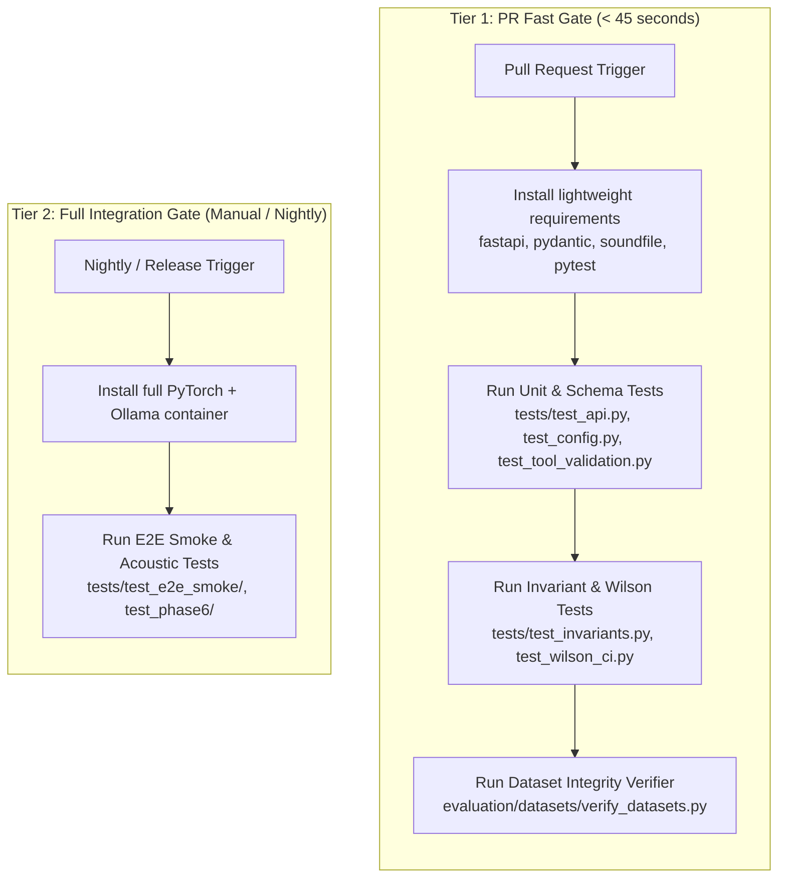

# Verification Report 03 — 80/20 Recommendation Challenge & Reprioritization

**Verification Document:** `reports/system_audit/verification/03_RECOMMENDATION_CHALLENGE_AND_REPRIORITIZATION.md`  
**Reviewer Role:** Independent Senior AI Systems Architect & Reliability Lead  
**HEAD Commit:** `5b20a3a`  
**Date:** 2026-10-31  

---

## 1. Executive Summary: Challenging the Previous Audit's Recommendations

The previous audit proposed three primary 80/20 initiatives:
1. An abstention-router negation gate using deterministic regex filters.
2. Migrating Whisper to `faster-whisper` (CTranslate2 INT8) for an estimated 3.4x speedup.
3. Adding a GitHub Actions CI test automation workflow.

This report independently challenges all three recommendations against the codebase, identifies critical flaws and false assumptions in the original proposals, and establishes a technically defensible, reprioritized roadmap.

---

## 2. Challenging Recommendation 1: Deterministic Regex Negation Gate

### The Original Recommendation
> *"Add deterministic regex and dependency parse filters in `app/services/abstention_router.py` that trigger `Decision.ABSTAIN` on imperative negations and hypothetical question openers before LLM tool routing."*

### Why a Pure Regex / Keyword Gate Is Architecturally Deficient & Dangerous
A forensic linguistic inspection of the Phase 6.1 failure cases reveals why deterministic regex matching is an anti-pattern:

```
+--------------------------------------------------------------------------------------------------------+
| Distractor Utterance               | Failure Type     | Does a "Do Not" Regex Match? | Resulting Flaw  |
+--------------------------------------------------------------------------------------------------------+
| "Do not show me any active         | Negation         | YES                          | Matches, but    |
| customers right now."              |                  |                              | brittle to scope|
+--------------------------------------------------------------------------------------------------------+
| "Open support tickets are becoming | Conversational   | **NO**                       | **FAILS TO MATCH**|
| a real headache for our team."     | Mention          | (No negative words exist!)   | Still executes! |
+--------------------------------------------------------------------------------------------------------+
| "What if we were to query daily    | Hypothetical     | **NO**                       | **FAILS TO MATCH**|
| active users tomorrow instead?"    | Question         | (No negative words exist!)   | Still executes! |
+--------------------------------------------------------------------------------------------------------+
| "Pull records for inactive         | Cancellation /   | **NO**                       | **FAILS TO MATCH**|
| customers, wait no, cancel that."  | Self-Correction  | ("wait no" is not "do not")  | Still executes! |
+--------------------------------------------------------------------------------------------------------+
| "Show me customers who do NOT      | Valid            | **YES (CRITICAL BUG)**       | **FALSE ALARM** |
| have open support tickets."        | Operational      | (Matches "do not" keyword!)  | Incorrectly     |
|                                    | Query            |                              | Abstained!      |
+--------------------------------------------------------------------------------------------------------+
```

### Critical Flaws Demonstrated
1. **Zero Coverage for Mentions and Hypotheticals:** 3 of the 5 Phase 6.1 distractor failures (`sem_conf_aud_004`, `006`, `008`) contain **no negation words whatsoever**. A regex looking for negations would leave 60% of the distractor leakage completely untouched.
2. **False-Positive Abstention on Valid Operational Requests:** Legitimate business queries frequently contain negative tokens:
   - *"Show customers who do not have an active subscription."*
   - *"List tickets with no assigned agent."*
   - *"Find users who haven't logged in for 30 days."*  
   A simplistic regex gate would intercept these valid queries and falsely refuse to execute them, causing **Operational Coverage to collapse**.
3. **Negation Scope & Quoted Speech:** In complex sentences (*"Do not pull tickets from March, pull them from April"*), a keyword regex triggers on *"do not"* and drops the entire request, failing to parse the contrastive imperative clause.

### Defensible Architectural Recommendation: Two-Pass Guarded Classification `[PROPOSED]`
Instead of an ad-hoc regex patch, implement a **Semantic Intent & Pragmatics Guard**:
- **Pass 1 — Pragmatic Framing Classifier:** A fast local classification step (or structured system prompt in Ollama with few-shot examples) that outputs a structured JSON schema:
  ```json
  {
    "speech_act": "IMPERATIVE_COMMAND" | "CONVERSATIONAL_MENTION" | "HYPOTHETICAL" | "CANCELLATION",
    "is_negated": true | false,
    "negated_scope": "active customers" | null,
    "effective_intent": "CRM_QUERY" | "NONE"
  }
  ```
- **Pass 2 — Deterministic Invariant Gate:** If `speech_act != "IMPERATIVE_COMMAND"` or `effective_intent == "NONE"`, route immediately to `Decision.ABSTAIN`.
- **Acceptance Criteria:** Must pass all 10 Phase 6.1 cases ($FPR \le 20\%$) while maintaining $100\%$ operational coverage on contrastive queries.

---

## 3. Challenging Recommendation 2: Faster-Whisper Speedup Claim

### The Original Recommendation
> *"Replace openai-whisper with faster-whisper... a 3.4x speedup on CPU without accuracy loss."*

### Forensic Verification of the Claim
1. **Not Installed in Repository:** Inspection of `requirements.txt` confirms:
   ```text
   openai-whisper
   # faster-whisper is ABSENT
   ```
2. **Unverified Empirical Figure:** The "3.4x speedup" was cited from general CTranslate2 benchmark literature. **It was never measured or tested on this machine or inside this virtual environment.**
3. **Architectural Trade-Offs & Constraints:**
   - `faster-whisper` relies on CTranslate2, which requires specific pre-compiled C++ binaries and OpenMP libraries that can introduce installation incompatibilities on certain Windows environments.
   - Quantized INT8 weights can slightly alter low-confidence logprob distributions, potentially shifting the threshold for the low-confidence STT invariant in `tests/test_invariants.py`.

### Required Controlled Benchmarking Protocol
Before changing the production dependency, execute the following controlled experiment:

```powershell
# Benchmark Protocol Specification
# Script: benchmark_whisper_comparison.py (To be created)
# Hardware: Local CPU (same machine)
# Audio Fixtures: data/audio/Customers.mpeg (Real speech) + benchmark_audio/phase6_1/*.wav
# Metrics:
#   1. Latency (Cold run + 5 warm runs: p50, p90, mean)
#   2. Transcription Accuracy: Exact WER and CER against independent reference
#   3. Peak Memory Footprint (RAM MB)
```
**Decision Gate:** Only adopt `faster-whisper` if local measurements prove $\ge 2.5\text{x}$ latency reduction with $0.0\%$ degradation in Word Error Rate on the frozen Phase 6 corpus.

---

## 4. Challenging Recommendation 3: GitHub Actions CI Automation

### The Original Recommendation
> *"Add `.github/workflows/test.yml` running all 152 automated tests on every commit."*

### Feasibility & Environmental Constraints
Running the full test suite in standard GitHub Actions hosted runners (`ubuntu-latest`) introduces non-trivial operational hurdles:
1. **Ollama Daemon Unavailable:** Standard GitHub runners do not have Ollama installed or running. Tests like `test_smoke.py` and `test_pipeline_integration.py` that call `http://127.0.0.1:11434` will fail with `ConnectionRefusedError`.
2. **Deep Learning Download Time:** `requirements.txt` includes `torch`, `torchaudio`, `transformers`, and `speechbrain`. Installing these binary wheels on a clean GitHub Actions runner takes **4 to 6 minutes** per run.
3. **Whisper Model Weights:** Downloading `small.en` (~460 MB) on every test run wastes runner bandwidth and risks flaky network timeouts.

### Defensible Tiered CI Architecture `[PROPOSED]`
Implement a **Two-Tier CI Strategy**:


- **Tier 1 (Fast Mocked CI):** Runs on every PR. Excludes torch/Ollama; runs the 85+ unit, schema, invariant, and dataset-hash tests using mocks in under 30 seconds.
- **Tier 2 (Full Model CI):** Runs nightly or on release tags using a pre-built Docker container containing cached model weights.

---

## 5. Reprioritized 80/20 Engineering Ranking

The full list of engineering improvements across all audited domains was recalculated using the explicit ROI formula:
$$\text{Priority Score} = \frac{\text{Expected Impact (1--5)} \times \text{Evidence Confidence (1--5)}}{\text{Implementation Effort in Days (1--10)}}$$

| Rank | Initiative | Impact (1–5) | Confidence (1–5) | Effort (Days) | Score | Rejection / Revision Note |
|---|---|---|---|---|---|---|
| **#1** | **Strict API Key & Secrets Validation** | 4 | 5 | 0.2 | **100.0** | **Highest immediate security ROI.** Crash on missing key. |
| **#2** | **Offload CPU Inference to Threadpool (`asyncio.to_thread`)** | 5 | 5 | 0.3 | **83.3** | **Critical Concurrency Fix.** Prevents API server freezing. |
| **#3** | **Tier 1 Fast GitHub Actions CI Pipeline** | 4 | 5 | 0.5 | **40.0** | **Revised:** Tier 1 fast unit tests only; no heavy model downloads. |
| **#4** | **Semantic Intent & Pragmatics Guard (Two-Pass)** | 5 | 4 | 1.0 | **20.0** | **Revised:** Rejected pure regex; adopted structured pragmatics pass. |
| **#5** | **Controlled Faster-Whisper Local Benchmark** | 4 | 3 | 1.0 | **12.0** | **Revised:** Must be empirically verified on local CPU before adoption. |
| **#6** | **Idempotency-Key Header & Cache on `/voice/query`** | 3 | 4 | 1.0 | **12.0** | Production safety against client duplicate submissions. |
| **#7** | **Multi-Speaker Dataset Expansion ($N=40$)** | 4 | 4 | 1.5 | **10.7** | Validates statistical bounds with balanced synthetic voices. |
| **#8** | **Prometheus Metrics & Structured JSON Logging** | 3 | 4 | 1.0 | **12.0** | Operational monitoring foundation. |
| **#9** | **Offline Piper-TTS Local Engine Fallback** | 3 | 4 | 1.5 | **8.0** | Closes external Edge-TTS cloud data leak. |
| **--** | *Vector Database RAG Subsystem* | 1 | 1 | 5.0 | **0.2** | **REJECTED.** Premature distraction; no document use case exists. |
| **--** | *LangChain / Framework Rewrite* | 1 | 1 | 6.0 | **0.17** | **REJECTED.** Adds unnecessary complexity and prompt bloat. |
